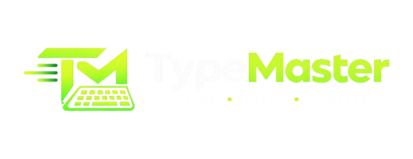

<div align="center">



# TypeMaster — Typing Practice & Keyboard Speed Trainer

[](https://react.dev/)
[](https://vitejs.dev/)
[](https://tailwindcss.com/)
[](https://www.typescriptlang.org/)
[](https://typemaster-ecru.vercel.app)

**A modern, all-in-one keyboard speed training ecosystem with 3D AI companion coaching.**  
Practice touch typing in **English** and **Bangla (বাংলা)** with real-time telemetry, 1-minute sprint challenges, celebratory video feedback, interactive key-row lessons, and adrenaline typing games.

[Live Demo](https://typemaster-ecru.vercel.app) • [Features](#-key-features) • [Installation](#-getting-started) • [Tech Stack](#️-technology-stack)

---

</div>

## 🌟 Key Features

### ⏱️ 1-Minute & Custom Minute Word Count Speed Test
- **Minute-Wise Target Sprints:** Select 1 Minute, 2 Minutes, 3 Minutes, or 5 Minutes with live countdowns.
- **Dual Typing Modes:**
  - *Word Stream Mode:* Rapid word-by-word flow with instant correct/error color feedback.
  - *Free Typing Mode:* Creative typing for essays and paragraphs with live word count.
- **Fully Responsive Duration Row:** 100% responsive grid buttons (`1m`, `2m`, `3m`, `5m`) optimized for all mobile screen sizes.

### 🎬 3D Animated Speed Coach (Kami) & Video-like Motion
- **Lifelike Motion Companion:** 3D animated companion typing on a laptop with fluid breathing, head-bobbing, active hand typing vibration, and floating ASDF 3D keycaps.
- **Dynamic Speech Bubble & Audio Voice:** Real-time cheering reacting to live typing speed (`"Good job! You did great work speed!"`) with interactive speech synthesis audio toggle.

### 🎥 Celebratory Video Popup (`gratejobvideo.mp4`)
- **Instant Video Celebration:** When any speed challenge completes, an animated modal pops up auto-playing `gratejobvideo.mp4`.
- **One-Click Replay:** Features a glowing `"Let's Do It Again! 🚀"` action button to jump straight into the next typing workout.

### ⌨️ Dual-Language Typing Console
- **Bangla (বাংলা) & English Support:** Practice both global English passages and native Bengali scripts with authentic typography.
- **Real-Time Telemetry:** Instant live calculations of WPM, Accuracy %, character errors, and countdown timers.
- **Mechanical Sound Effects:** Acoustic key-click audio feedback with quick mute toggle.

### 🎥 Big Cinematic Hero Video
- **Interactive Showcase Player:** Integrated `herovideo.mp4` with custom glassmorphism bezel and neon ambient backlight.
- **Player Controls:** Click-to-play/pause, scrubbable progress bar, volume toggle, restart, and fullscreen modes.

### 📚 Learning Center & Skill Drills
- **Finger Placement Guides:** Visual interactive keyboard drills targeting Home Row, Top Row, Bottom Row, and Number/Symbol Rows.
- **Speed Drills:** Focus on weak fingers and improve muscle memory systematically.

### 🎮 Typing Games
- **Time Sprint:** Fast-paced adrenaline drills to shatter personal speed records.
- **Accuracy Defense:** Challenge yourself to achieve 98%+ precision without backspaces.

### 📊 Performance Analytics & Leaderboard
- **Detailed History:** Tracks the last 50 tests in local storage with timestamps, passage snippets, and statistics.
- **Local Leaderboards:** Compare and rank your best scores against preset milestone benchmarks.

---

## 🛠️ Technology Stack

| Layer | Technologies |
|---|---|
| **Frontend** | React 19, TypeScript, Vite 8, Tailwind CSS v4, Motion, Lucide React |
| **Backend** | Node.js, Express 4, `@google/genai` (Gemini SDK) |
| **Engines** | High-precision Keystroke Telemetry, WPM/Accuracy Computation Engine |
| **Aesthetics** | Dark Mode (`#111310`), Neon Lime Accent (`#d7ff64`), Glassmorphism, Responsive Mobile Drawer |

---

## 🚀 Getting Started

### Prerequisites
- [Node.js](https://nodejs.org/) (version 18 or higher recommended)
- [npm](https://www.npmjs.com/)

### 1. Clone the Repository
```bash
git clone https://github.com/jasminaramim/-TypeMaster.git
cd -TypeMaster
```

### 2. Install Dependencies
```bash
npm install --legacy-peer-deps
```

### 3. Run the Development Server
```bash
npm run dev
```
Open your browser and navigate to **[http://localhost:3000](http://localhost:3000)**.

### 4. Run the Development Server
```bash
npm run dev
```
Open your browser and navigate to **[http://localhost:3000](http://localhost:3000)**.

---

## 📦 Production Build

To build the client bundle for production:
```bash
npm run build
```

To start the server in production mode:
```bash
npm start
```

To run type checking:
```bash
npm run lint
```

---

## 📂 Project Structure

```text
typemaster/
├── public/
│   ├── herovideo.mp4       # Big hero section showcase video
│   └── logo.png            # Official TypeMaster brand logo
├── src/
│   ├── components/
│   │   ├── Header.tsx          # Full-width navigation header with brand logo
│   │   ├── HeroSection.tsx     # Big hero section with video player and CTAs
│   │   ├── TypingTest.tsx          # Guided passage speed workout & telemetry
│   │   ├── MinuteSpeedChallenge.tsx # 1-min & custom minute speed challenge with 3D companion
│   │   ├── CelebrationPopup.tsx    # Celebratory video popup upon challenge finish
│   │   ├── LearningCenter.tsx      # Finger placement drills & lesson center
│   │   ├── TypingGames.tsx         # Arcade speed arena (Nitro Racer, Cosmic Blaster, etc.)
│   │   ├── HistoryView.tsx         # Historical tests and stats
│   │   ├── LeaderboardView.tsx     # Leaderboard ranks and badges
│   │   └── Footer.tsx              # App footer with brand logo and links
│   ├── data/
│   │   └── passages.ts             # Curated English & Bangla practice passages
│   ├── utils/
│   │   └── sound.ts                # Web Audio mechanical keyboard synthesizer
│   ├── App.tsx                 # Main application controller
│   ├── index.css               # Core design tokens & Tailwind imports
│   └── main.tsx                # React root mount
├── server.ts                   # Express API endpoints & Vite SPA middleware
├── vite.config.ts              # Vite configuration
├── package.json                # Project dependencies and scripts
└── README.md                   # Documentation
```

---

## 📄 License

This project is licensed under the [MIT License](LICENSE).

---

<div align="center">
Crafted with ❤️ for typists, writers, and students worldwide.
</div>
